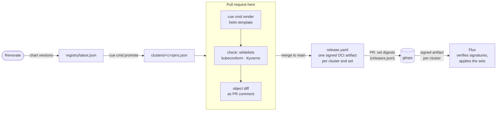

# platform-components

Everything cluster-scoped in the [homelab-selfuryon](https://github.com/homelab-selfuryon) platform,
as CUE: the cluster definitions (Talos), the platform components (charts rendered to plain objects),
the Kyverno policies and the onboarding of product teams. The delivery flow and the contracts
between the repositories are in
[`meta/delivery.md`](https://github.com/homelab-selfuryon/meta/blob/main/delivery.md).

CUE module `github.com/homelab-selfuryon/platform-components@v0`. Owner: the platform team.

## How it fits



This repository holds _inputs_: component definitions and the version pins of each cluster. Where
each cluster runs which artifact (the output lock) is `gitops`; rollback is a revert there. PR checks
call `components-check.yaml` from `github-workflows`. The release (push and sign the set artifacts,
PR to `gitops`) runs in this repository's own `.github/workflows/release.yaml`, so the signature
names this repository and `main` — Flux accepts nothing else.

## Layout

```
cue.mod/                       module github.com/homelab-selfuryon/platform-components@v0
schema/                        #Cluster, #Component, #Chart, whitelist (#Allow), typed manifests
registry/                      latest.json (Renovate), #Resolve (channel + pins)
render/                        component -> Flux Kustomization, plain objects, meta for the render script
components/<category>/<name>/  one package per component (chart + typed values, plain objects,
                               namespace, network policy, cluster-scoped whitelist)
policies/                      Kyverno CEL policies (workloads, tenants, component ServiceAccounts)
teams/                         teams/<name>.cue onboarding + its render
bootstrap/                     what is applied by hand once
clusters/<cluster>/            cluster.cue, pins.json, talos/ (machine config patches + gen.sh)
clusters/defaults.cue          #Platform: the component list every cluster starts from
crd/                           CUE schemas generated with `cue get crd` (Cilium, Flux Operator, Kyverno)
ext_tool.cue                   `cue cmd` commands
scripts/                       render_component.py, check_whitelist.py, kyverno-check.sh, cue-vet.bash, ...
docs/                          bootstrap + break-glass, secrets, gateways, teams
.github/workflows/             check, release, promote, lint (callers of github-workflows)
```

## Commands

```bash
devenv shell                                   # cue, helm, kustomize, kyverno, cosign, oras, kubeconform, talosctl, yq, jq
cue cmd clusters                              # JSON: clusters, publish flag, sets
cue cmd render  -t cluster=alpha-01           # out/<c>/<set>/{flux,components/<name>}/  (needs network: helm pulls charts)
cue cmd check   -t cluster=alpha-01           # every cluster-scoped object of the render must match its component's whitelist
cue cmd bootstrap -t cluster=alpha-01         # out/<c>/bootstrap.yaml, applied by hand once (docs/bootstrap.md)
cue cmd promote -t to=alpha-01 [-t from=latest|<cluster>] [-t components=a,b]    # clusters/<to>/pins.json
bash scripts/cue-vet.bash                     # cue fmt --check and vet of every package
bash scripts/kyverno-check.sh alpha-01        # the rendered policies over the render; userInfo policies per component SA
```

## Sets and components on `alpha-01`

One signed artifact per set and cluster: `components/<name>/{kustomization.yaml,manifests.yaml}` plus
`flux/kustomizations.yaml`, one Flux `Kustomization` per component, each with its own ServiceAccount.

| Set        | Components (version)                                                                                                                                                                                                                                        |
| ---------- | ----------------------------------------------------------------------------------------------------------------------------------------------------------------------------------------------------------------------------------------------------------- |
| `rbac`     | `rbac` (privileged): namespaces, ServiceAccounts `component-<name>`, Roles and ClusterRoles generated from the components' whitelists; ServiceAccount `argo-apps`                                                                                           |
| `system`   | `cilium` 1.20.4 (priv.), `flux-operator` 0.62.1 + Flux v2.10.0 (priv.), `kyverno` 3.9.2 (priv., HelmRelease), `gateway-api` (Gateway API + Envoy Gateway CRDs) 1.10.0, `cert-manager` v1.21.3, `internal-ca`                                                |
| `policy`   | `kyverno-policies`, `host-firewall`: right after `system`, before any platform component                                                                                                                                                                    |
| `platform` | `local-path-provisioner` v0.0.37, `metrics-server` 3.14.0, `envoy-gateway` 1.10.0, `external-dns` 1.23.0, `cnpg` 0.29.1, `secrets-store-csi-driver` 1.6.2, `openbao` 0.30.7, `openbao-csi-provider` 0.30.7, `argocd` 10.15.0, `cluster-issuers`, `gateways` |
| `tenants`  | `team-notes` (from `teams/notes.cue`)                                                                                                                                                                                                                       |

Versions come from `registry/latest.json` through `clusters/alpha-01/pins.json`. OCI charts are
pinned by digest as well (`1.2.3@sha256:...`): Helm verifies the content.

## What the render guarantees

- **Plain objects, no Helm in the cluster.** `helm template` runs in CI from typed CUE values
  (`--kube-version` and `--api-versions` from the cluster definition). Helm hooks: install hooks
  become ordinary objects, upgrade/delete/test hooks are dropped (`scripts/render_component.py`).
  `variant: "helmrelease"` is the listed exception for a chart whose hooks or `lookup` matter
  (Kyverno on alpha-01: its upgrade hooks migrate stored resources, its delete hooks remove the
  webhooks first). The artifact then holds a `HelmRelease` and its `OCIRepository` (chart by digest)
  in `flux-system`, installing into the component's namespace as the component's ServiceAccount
  (policy `helmrelease-service-accounts`); CI still renders the chart, hooks included, to
  `out/<c>/.approx` for the diff, the whitelist and Kyverno without publishing it. Only privileged
  components may use it for now.
- **Deterministic.** Two renders of the same inputs are byte-identical (checked), so an unchanged set is
  never re-published.
- **Cluster-scoped whitelist, enforced three times.** A component lists the cluster-scoped kinds and
  names it may create. `cue cmd check` verifies the render; the `rbac` set gives the component's Flux
  ServiceAccount RBAC for exactly those kinds (and `escalate`/`bind` on exactly its ClusterRoles);
  the policy `component-whitelist` checks the names at admission (which RBAC `create` cannot
  restrict). Tenants have none.
- **A Kustomization can only use its own ServiceAccount**: policy `kustomization-service-accounts`
  (and a HelmRelease: `helmrelease-service-accounts`).
  Core components (Cilium, Flux, Kyverno, the `rbac` set) are `privileged` with a written reason and
  run as `flux-privileged`; the default ServiceAccount of Flux has no rights.
- **Namespaces belong to the platform.** The `rbac` set creates every component namespace
  (`<name>-system`, Pod Security `restricted` unless `psa` says why not), so a compromised chart cannot
  relabel its own namespace; each gets a generated default-deny and the component's own network policy.

## Secrets

None in git, encrypted or not. OpenBao is the store (static seal, key created at bootstrap and kept
offline); platform components that need a Kubernetes Secret get it from the CSI driver, allowed in
`*-system` namespaces only. [docs/secrets.md](docs/secrets.md).

## Placeholders

`homelab.example`, 192.0.2.0/24, 2001:db8::/32, the interface `eth0` and the install disk are
placeholders until a real domain and network exist (open question in `meta/decisions.md`). The Talos
patches contain no real address, disk, MAC or serial.

## Development

Conventional Commits (`feat(cilium): ...`, `fix(policies): ...`, `!` for breaking changes), signed
commits, PRs. Read `CLAUDE.md` for the conventions and `.claude/skills/` for how to add a component or
a CRD schema.

License: Apache-2.0.
