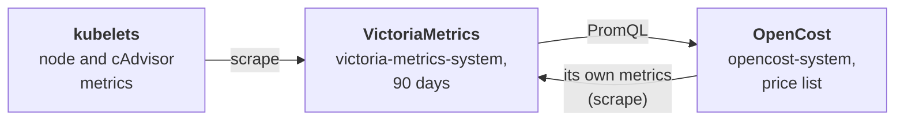

# FinOps: what the cluster costs, per team and environment

There is no cloud bill: the cost is the machine (amortized) and its power. OpenCost spreads that
over the workloads from what they request and use, read from VictoriaMetrics.



- **Prices** are in `components/observability/opencost/opencost.cue` (`_prices`), per CPU core-hour,
  GB-hour of memory and GB-hour of disk, with the formula next to them. The committed values are
  placeholders.
- **Nothing is exposed.** UI and API by port-forward:
  `kubectl -n opencost-system port-forward svc/opencost 9090 9003`, then <http://localhost:9090>.

## Questions and the API calls that answer them

```bash
api=http://localhost:9003/allocation/compute
# cost per namespace over the last 7 days, idle capacity as its own line
curl -sG $api -d window=7d -d aggregate=namespace -d accumulate=true | jq '.data[0] | map_values(.totalCost)'
# per team and per environment (namespace labels, keys with dots and slashes become underscores)
curl -sG $api -d window=30d -d aggregate=label:homelab_selfuryon_github_io_team -d accumulate=true
curl -sG $api -d window=30d -d aggregate=label:homelab_selfuryon_github_io_env -d accumulate=true
# requested vs used (efficiency) per namespace
curl -sG $api -d window=7d -d aggregate=namespace -d accumulate=true |
  jq '.data[0] | map_values({cpu: .cpuEfficiency, ram: .ramEfficiency, cost: .totalCost})'
```

## Not yet

Kepler (watts per pod, needs a privileged DaemonSet), rightsizing reports (KRR against
VictoriaMetrics), scale-to-zero of previews and staging at night, a Grafana dashboard. Tracked under
FinOps in `meta/decisions.md`.
